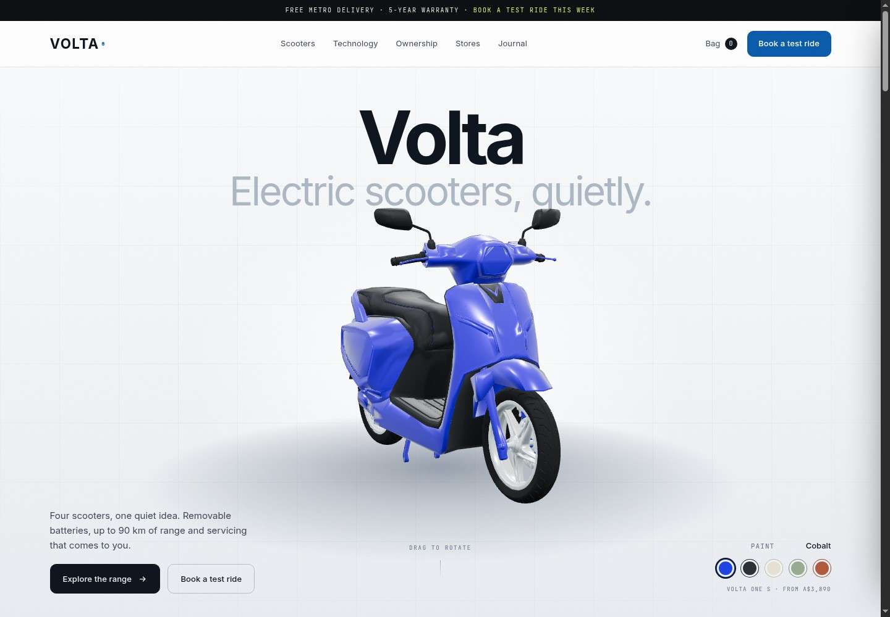
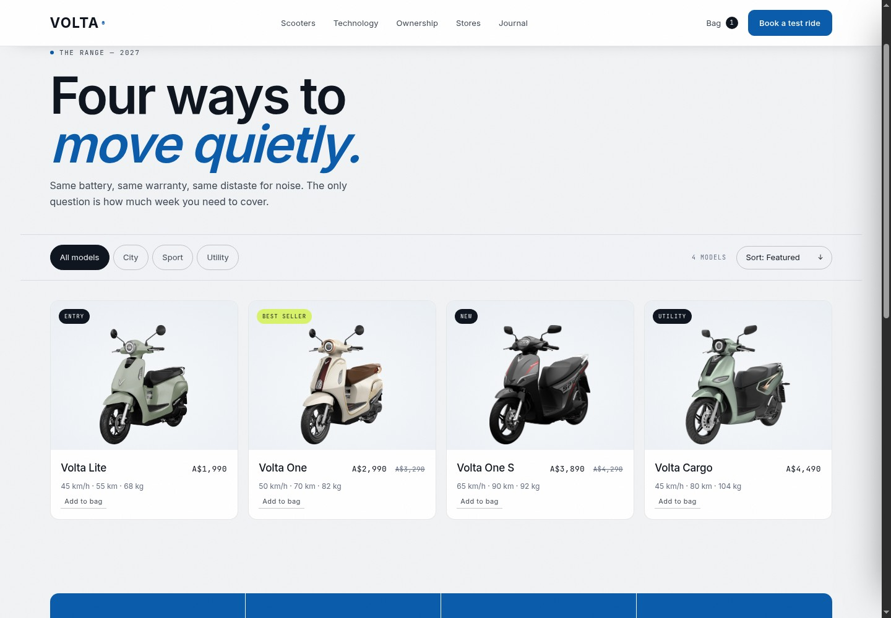
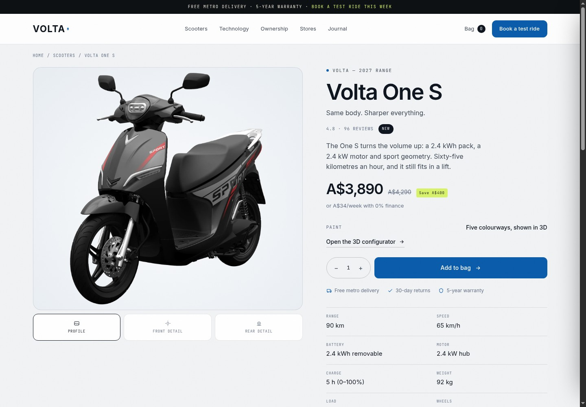

<div align="center">

# Volta

**A production-quality ecommerce storefront demo for a fictional Australian electric-scooter brand.**

Static site · Real-time 3D product configurator · No build step

[Live demo](https://tricuongdao.github.io/volta-ecommerce-demo/) · [Report an issue](https://github.com/tricuongdao/volta-ecommerce-demo/issues)



</div>

---

## Overview

Volta is a complete, front-end-only storefront: a 3D product hero, a filterable
catalogue, product detail pages with a working bag, and a checkout flow that
completes with an order confirmation. Everything runs from static files — there is
no bundler, framework or backend to install.

The project is intended as a portfolio piece and a starting point for client demos.
Product data, pricing (AUD, GST-inclusive) and editorial content live in one module,
so the shop can be re-skinned or extended without touching markup.

## Highlights

- **Real-time 3D hero** — a Draco-compressed GLB rendered with Three.js, drag to
  rotate with inertia, idle turntable, studio environment, soft shadows and five
  live paint finishes. Pauses off-screen and falls back to a procedural model.
- **3D configurator** — a second viewer with model, colour and price selection.
- **Full commerce flow** — catalogue with filters and sorting, product pages,
  slide-over bag with quantity controls, checkout with promo code (`RIDE10`),
  standard/express delivery and an order confirmation state.
- **Persistent bag** — lines keyed by product and colour, stored in `localStorage`.
- **Editorial sections** — technology tabs, 0% finance calculator, reviews,
  showrooms, journal and a validated test-ride booking form.
- **Responsive and accessible** — 360 px to 1440 px, visible focus states, semantic
  landmarks, skip link, labelled controls, reduced-motion support and no-JS reveal
  fallbacks.
- **Zero dependencies at runtime** — Three.js and its loaders are vendored; fonts
  are self-hosted.

## Screenshots

| Catalogue | Product page |
| --- | --- |
|  |  |

## Tech stack

| Layer | Choice |
| --- | --- |
| Markup | Semantic HTML5, four static pages |
| Styling | Modern CSS — custom properties, Grid, `clamp()`, `color-mix()`, aspect-ratio |
| Behaviour | Vanilla ES modules (`data.js`, `app.js`, `scooter.js`, `scooter3d.js`) |
| 3D | Three.js r160, `GLTFLoader`, `DRACOLoader`, Draco decoder (vendored) |
| Assets | WebP product photography, WOFF2 fonts, GLB model |
| Tooling | None required — any static server |

## Getting started

```bash
git clone https://github.com/tricuongdao/volta-ecommerce-demo.git
cd volta-ecommerce-demo
python3 -m http.server 8123
# open http://127.0.0.1:8123
```

Or with npm:

```bash
npm run dev      # python3 -m http.server 8123
npm run preview  # npx serve -l 8123 .
```

A server is required: the site uses ES modules, and the Draco decoder is fetched at
runtime.

## Project structure

```
.
├── index.html              # 3D hero, range, configurator, technology, finance, booking
├── shop.html               # filterable catalogue
├── product.html            # product detail (?model=…)
├── checkout.html           # bag summary, delivery, confirmation
├── assets/
│   ├── css/main.css        # design tokens and every component
│   ├── js/
│   │   ├── data.js         # catalogue, colours, reviews, stores, journal
│   │   ├── app.js          # rendering, cart, configurator, PDP, checkout, forms
│   │   ├── scooter.js      # parametric SVG fallback renderer
│   │   └── scooter3d.js    # Three.js scene, model loading, paint switching
│   ├── models/             # 3D scooter model (GLB)
│   ├── img/products/       # transparent product photography (WebP)
│   ├── fonts/              # self-hosted Inter + JetBrains Mono
│   └── vendor/             # Three.js, GLTFLoader, DRACOLoader, Draco decoder
└── docs/                   # README screenshots
```

## Customising

- **Catalogue and pricing** — edit `assets/js/data.js`. Every card, filter, product
  page, finance figure and bag line derives from that array.
- **Brand** — colours, radii, type scale and spacing live in the `:root` tokens at
  the top of `assets/css/main.css`.
- **3D model** — replace `assets/models/volta-one-s.glb` and update `MODEL_URL` in
  `assets/js/scooter3d.js`; materials are assigned by mesh name (`Body`, `Tire_*`,
  `Disk_*`, `Plastic`, `Sedlo`).
- **Product photography** — drop transparent WebP files into
  `assets/img/products/` and point each product's `image` field at them.

## Deployment

The site is published with GitHub Pages from the `main` branch — every push
redeploys it. Because the output is static, it also deploys unchanged to Netlify,
Vercel, Cloudflare Pages or any object store.

## Browser support

Chrome/Edge 111+, Safari 16.4+, Firefox 128+. `color-mix()` and `aspect-ratio` are
used without a build step; older browsers receive a functional fallback. WebGL is
required for the 3D viewer — the SVG renderer is used otherwise.

## Accessibility

- Landmark elements, one `h1` per page, a skip link and visible focus rings.
- Labelled inputs, inline validation messages and `aria-invalid` on failure.
- Colour is never the only signal for selection.
- `prefers-reduced-motion` stops the turntable and reveal animations.
- The bag closes on Escape or overlay click and restores focus.

## License

Code is released under the [MIT License](LICENSE).

Product photography and the 3D scooter model are included for demonstration
purposes only and are **not** covered by the MIT license. Replace them with licensed
assets before any commercial deployment. Volta is a fictional brand; names, prices,
showroom details and reviews are illustrative.
